# Curso ROS 2 Jazzy

Este repositório registra, em ordem cronológica, o desenvolvimento do curso de ROS 2, lembrando que nem todo o curso estará aqui no README, tentarei pôr o que me parece importante.
Também não irei mostrar passos feitos anteriormente, como mostrar uma criação de nó novo, apenas direi que criei aquele nó e dizer sua funcionalidade.

O desenvolvimento foi realizado com ROS 2 Jazzy em um container Docker, utilizando o VS Code para edição dos arquivos e terminais separados.

## 1. Criação do pacote Python

O pacote `my_py_pkg` foi criado no workspace ROS 2 com o sistema de build `ament_python` e a dependência inicial `rclpy`.

```bash
cd /ros2_ws/src
ros2 pkg create my_py_pkg --build-type ament_python --dependencies rclpy
```

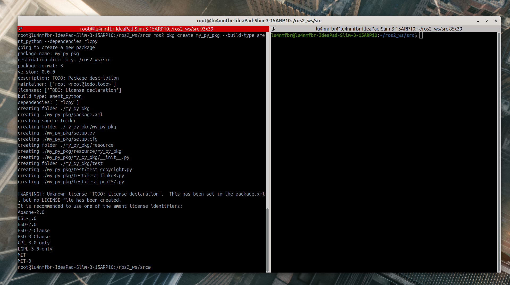

## 2. Criação do primeiro Node

Foi criado o arquivo `my_first_node.py` no módulo Python interno do pacote. Nesse primeiro exemplo, foi implementado um Node mínimo para acompanhar sua inicialização e execução.

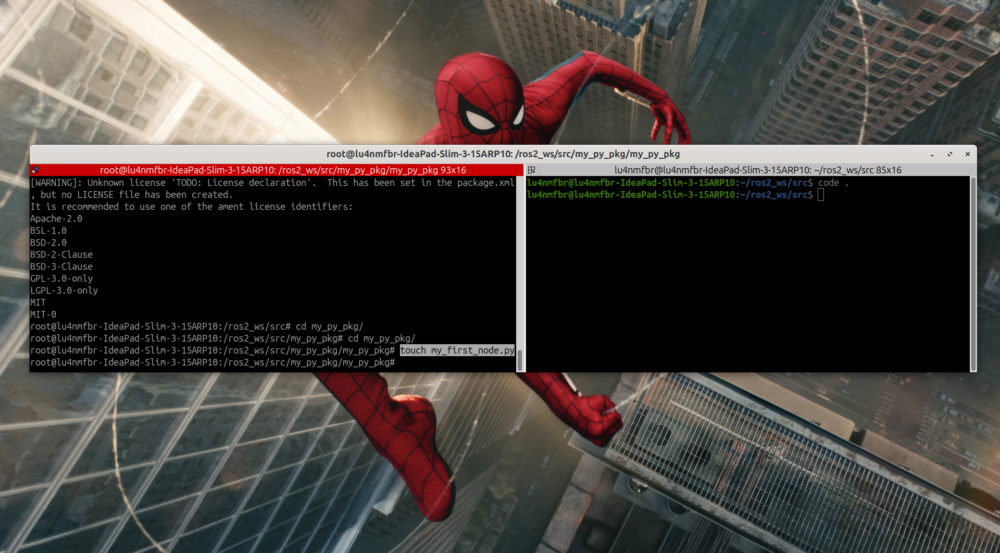

O executável `my_first_node_executable` foi registrado no `setup.py`.

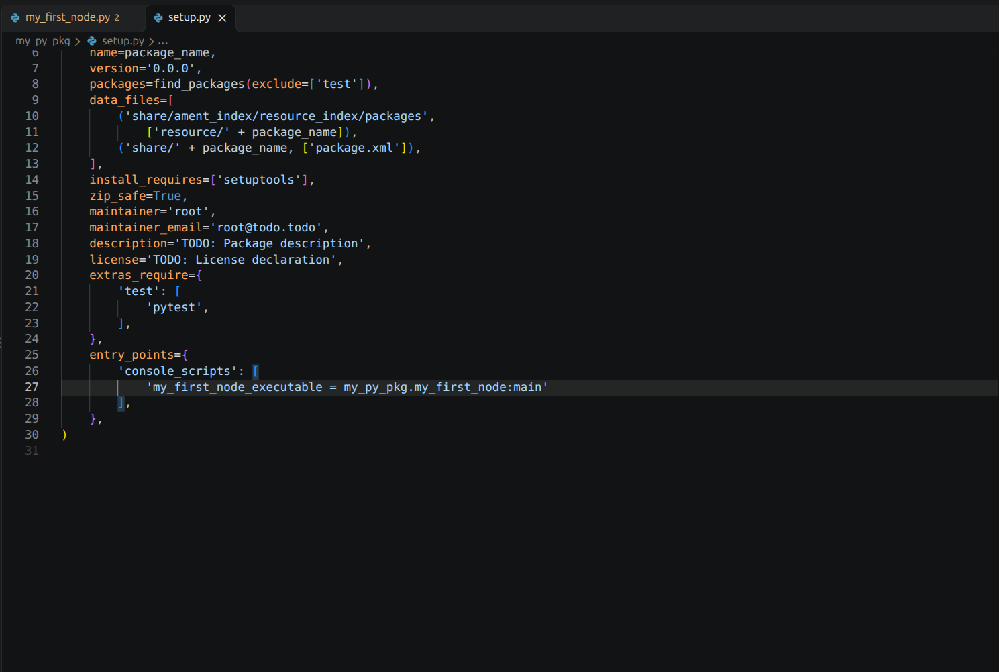

Após a compilação do pacote, o primeiro Node foi executado. A saída no terminal registra as mensagens produzidas durante a execução.

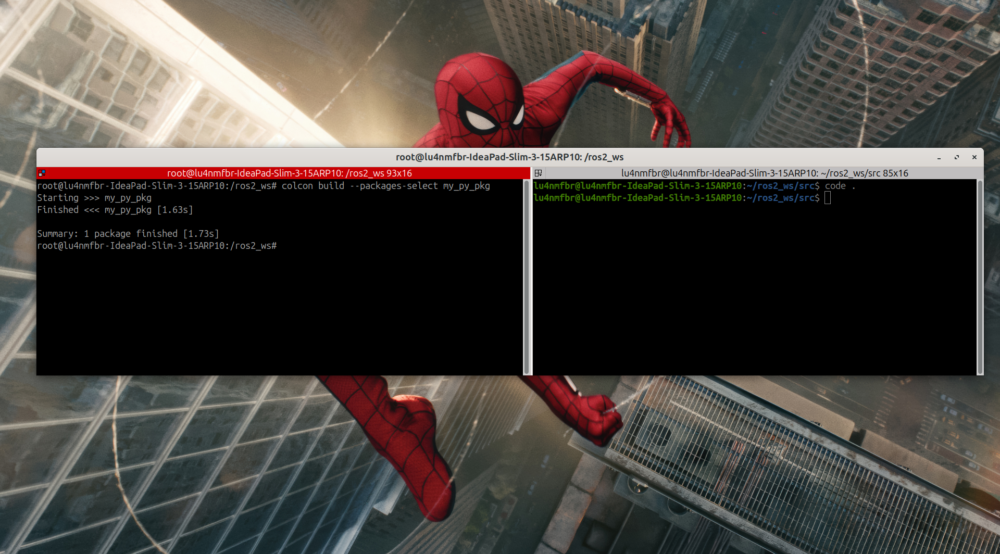

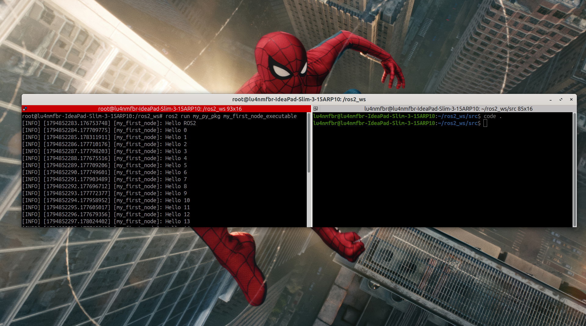

## 3. Implementação do Publisher

Foi criado o arquivo `robot_news_station.py`, responsável pela publicação periódica de mensagens.

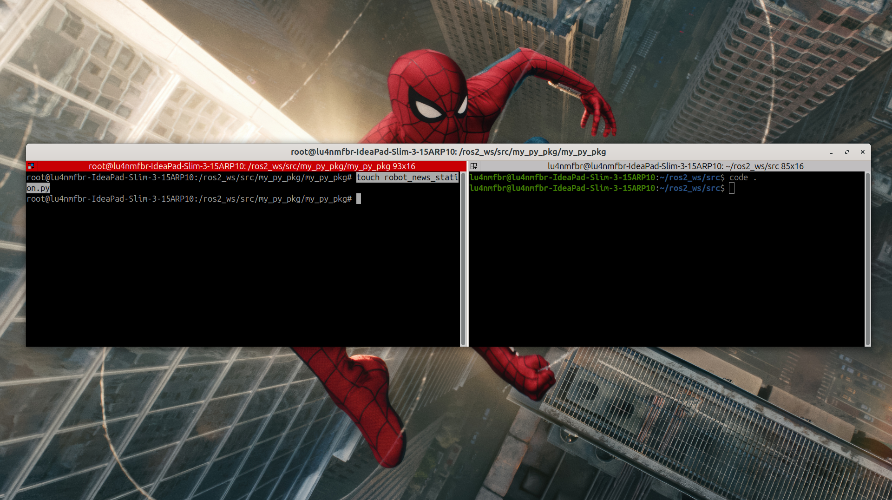

A implementação utiliza a classe `RobotNewsStationNode`, que herda de `Node`. O Publisher foi configurado com as seguintes características:

| Elemento | Configuração |
|---|---|
| Nome do Node | `robot_news_station` |
| Tipo de mensagem | `example_interfaces/msg/String` |
| Topic | `robot_news` |
| Profundidade da fila | `10` |
| Timer | `0,5 segundo` (aproximadamente 2 Hz) |
| Método de publicação | `publish_news()` |

O Timer agenda o método `publish_news()` a cada 0,5 segundo. A cada chamada, uma mensagem `String` é criada, seu campo `data` recebe o texto `Hi, this is R2-D2 bringing you the latest news!` e a mensagem é publicada no Topic `robot_news`.

Como o Publisher utiliza o tipo `String` de `example_interfaces`, essa dependência foi declarada no `package.xml`.

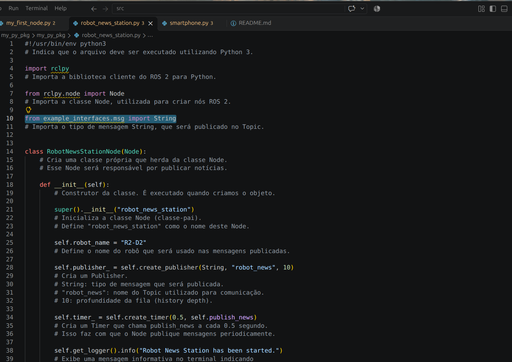

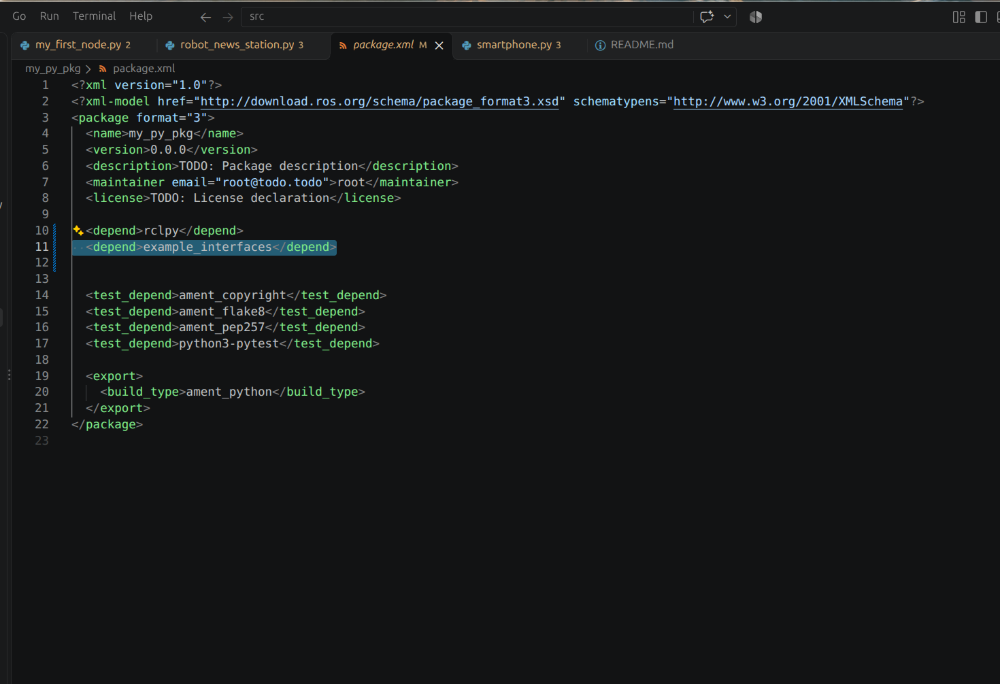

O executável `robot_news_station_executable` foi adicionado ao `setup.py`, mantendo também o executável do primeiro Node.

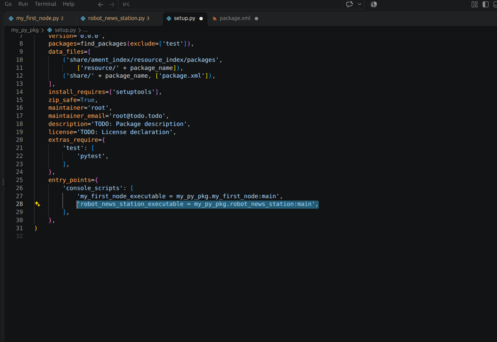

Após essa alteração, o pacote foi recompilado.

## 4. Implementação do Subscriber

Em seguida, foi criado o arquivo `smartphone.py`, contendo a classe `SmartphoneNode`.

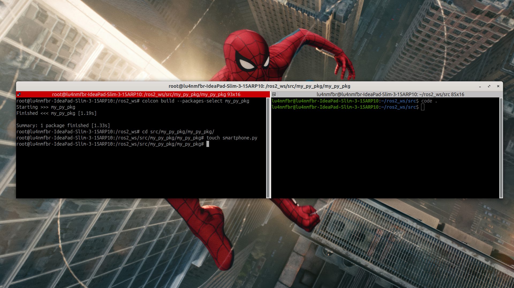

O Subscriber foi configurado para receber mensagens do tipo `String` no mesmo Topic `robot_news` utilizado pelo Publisher. O método `callback_receive_news()` trata as mensagens recebidas e exibe seu conteúdo no terminal.

O executável `smartphone_executable` também foi registrado no `setup.py`. Com isso, o pacote passou a contar com três executáveis: `my_first_node_executable`, `robot_news_station_executable` e `smartphone_executable`.

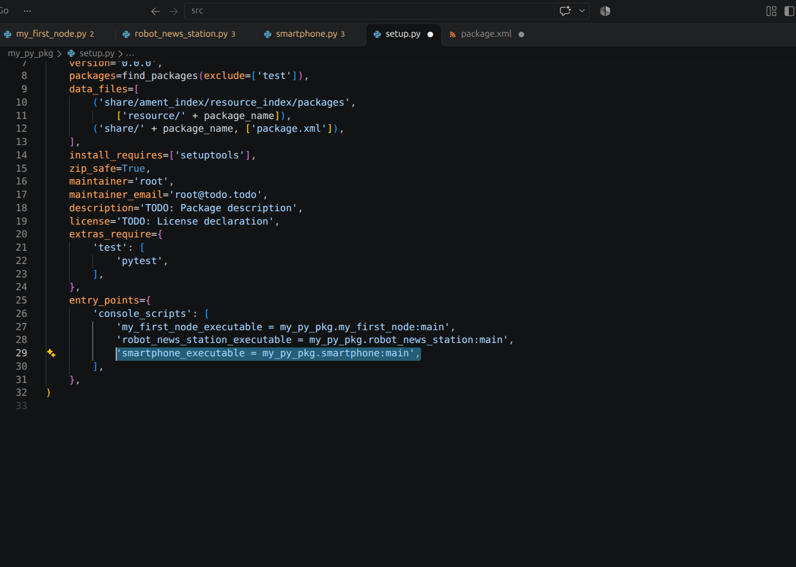

O pacote foi recompilado após o registro do Subscriber.

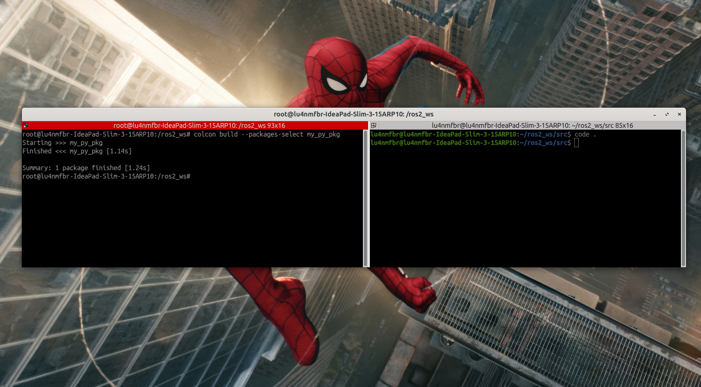

## 5. Comunicação entre Publisher e Subscriber

O Publisher `robot_news_station` e o Subscriber `smartphone` foram executados simultaneamente em terminais separados. O Publisher passou a publicar mensagens periodicamente, enquanto o Subscriber recebia e exibia o conteúdo recebido pelo Topic `robot_news`.

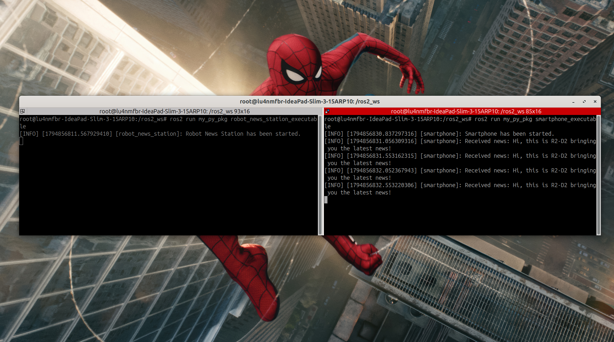

## 6. Visualização da comunicação com rqt_graph

Com os dois Nodes em execução, foi utilizado o `rqt_graph` para visualizar a comunicação estabelecida entre eles. Durante a inicialização, o terminal exibiu avisos relacionados ao acesso gráfico e ao driver AMD; a janela do `rqt_graph` foi aberta mesmo com esses avisos.

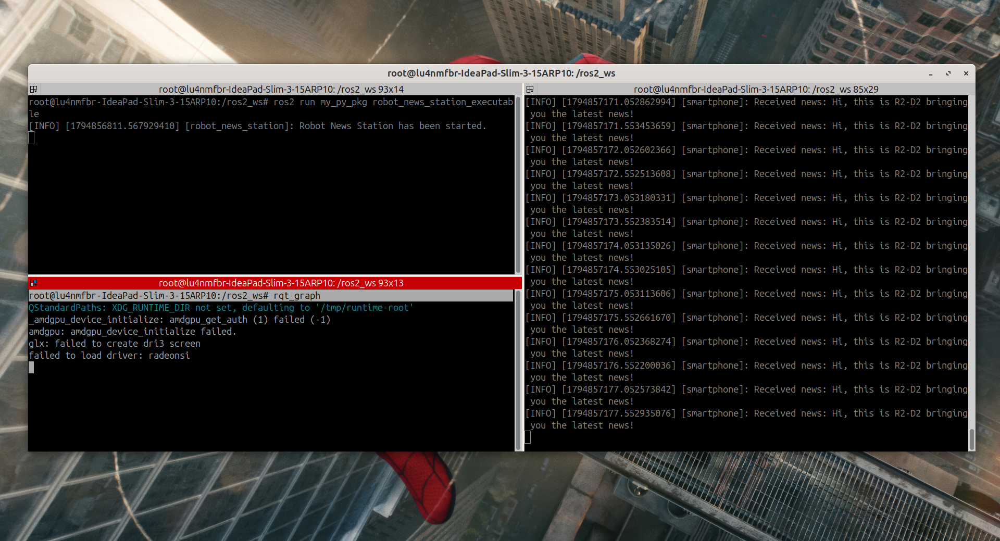

O grafo apresentou o fluxo entre o Publisher, o Topic e o Subscriber:

```text
/robot_news_station  →  /robot_news  →  /smartphone
       Publisher            Topic          Subscriber
```

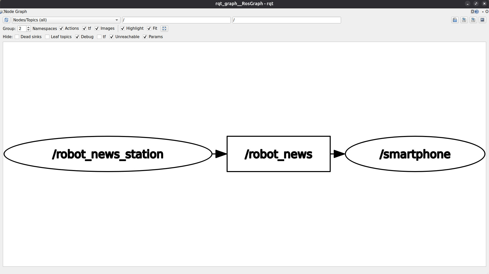

## 7. Execução simultânea de múltiplos Nodes e remapeamento

Na etapa seguinte, foram iniciadas seis instâncias simultâneas: três Publishers e três Subscribers. O argumento `__node` foi utilizado para atribuir nomes diferentes às instâncias. Além disso, o terceiro Publisher e o terceiro Subscriber foram direcionados para o Topic `robot_news_2`.

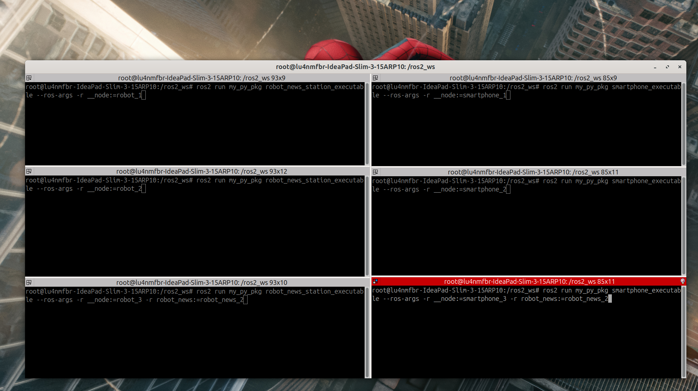

**Publishers:**

```bash
ros2 run my_py_pkg robot_news_station_executable --ros-args -r __node:=robot_1
ros2 run my_py_pkg robot_news_station_executable --ros-args -r __node:=robot_2
ros2 run my_py_pkg robot_news_station_executable --ros-args -r __node:=robot_3 -r robot_news:=robot_news_2
```

**Subscribers:**

```bash
ros2 run my_py_pkg smartphone_executable --ros-args -r __node:=smartphone_1
ros2 run my_py_pkg smartphone_executable --ros-args -r __node:=smartphone_2
ros2 run my_py_pkg smartphone_executable --ros-args -r __node:=smartphone_3 -r robot_news:=robot_news_2
```

O remapeamento `__node` altera o nome de cada instância sem modificar o código Python. O remapeamento `robot_news:=robot_news_2` altera o Topic utilizado pelos dois Nodes da terceira dupla.

A comunicação ficou organizada em dois grupos:

```text
robot_1 ──────┐                         ┌──── smartphone_1
              ├──── /robot_news ────────┤
robot_2 ──────┘                         └──── smartphone_2

robot_3 ─────────── /robot_news_2 ─────────── smartphone_3
```

Os dois Publishers conectados a `/robot_news` publicam no mesmo canal, e os dois Subscribers inscritos nesse Topic podem receber mensagens de ambos. Já `/robot_news_2` é utilizado pela terceira dupla, mantendo esse fluxo separado do primeiro.

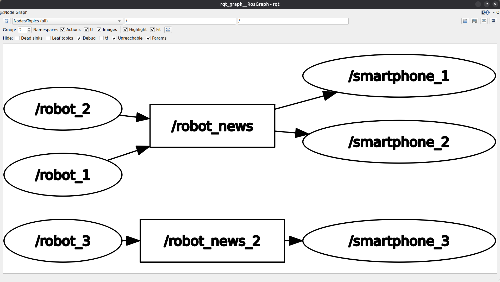

## 8. Atividade Prática 02: comunicação com tópicos e contador acumulador

Nesta atividade, foi implementado um sistema com dois Nodes que se comunicam por meio de Topics. O primeiro Node publica periodicamente um valor inteiro fixo, enquanto o segundo recebe esse valor, acumula a soma e publica o resultado atualizado.

A atividade utiliza o tipo de mensagem `example_interfaces/msg/Int64` e estabelece o seguinte fluxo:

```text
/number_publisher  →  /number  →  /number_counter  →  /number_count
     Publisher          Topic        Subscriber/Publisher      Topic
```

### 8.1. Node `number_publisher`

Foi criado o Node `number_publisher`, responsável por publicar o valor inteiro `2` no Topic `number`. Para isso, foi utilizado um Publisher do tipo `Int64` e um Timer configurado para chamar o método `publish_number()` a cada segundo.

A cada chamada do método, uma mensagem `Int64` é criada, seu campo `data` recebe o valor `2` e a mensagem é publicada no Topic `number`.

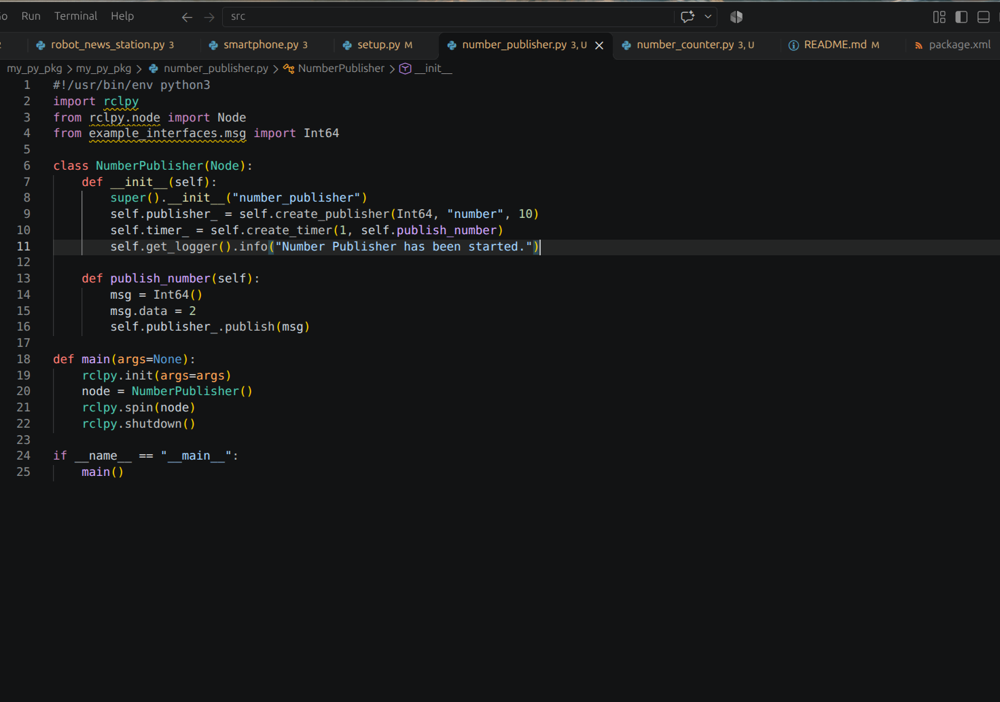

### 8.2. Node `number_counter`

Também foi criado o Node `number_counter`, que possui um Subscriber no Topic `number` e um Publisher no Topic `number_count`, ambos utilizando mensagens do tipo `Int64`.

A variável `contador` é inicializada com o valor `0`. Sempre que uma mensagem é recebida, o método `callback_number()` soma `msg.data` ao contador. Em seguida, uma nova mensagem `Int64` é criada com o total acumulado e publicada em `number_count`.

Dessa forma, como o Publisher envia o valor `2` a cada segundo, o contador aumenta em duas unidades a cada mensagem recebida.

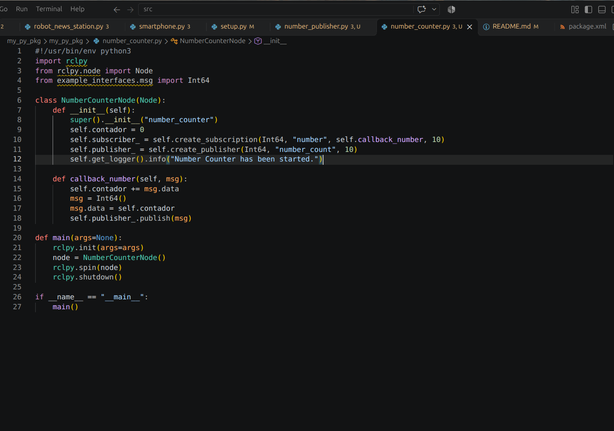

### 8.3. Execução e verificação

Os dois Nodes foram executados simultaneamente em terminais separados. Em um terceiro terminal, foi utilizado `ros2 topic echo /number_count` para acompanhar os valores publicados pelo contador.

```bash
ros2 run my_py_pkg number_publisher_executable
ros2 run my_py_pkg number_counter_executable
ros2 topic echo /number_count
```

Durante o trecho registrado, os valores observados foram `6`, `8`, `10`, `12`, `14`, `16`, `18` e `20`. A sequência confirma que o contador acumula o valor `2` recebido a cada publicação.

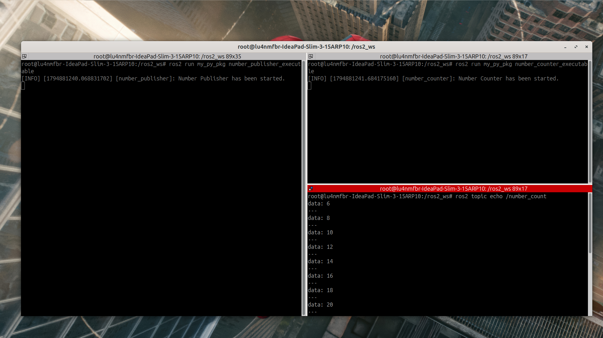

## Atualização do registro

Este README será atualizado até o fim do curso de ROS 2, incorporando os próximos conteúdos estudados, atividades práticas e registros do desenvolvimento.
